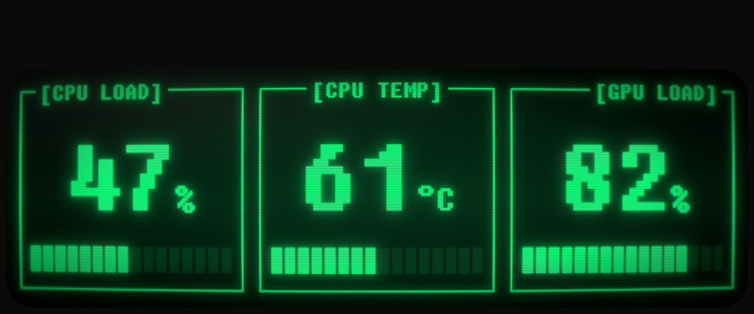

# System Monitor Display

<p align="center">
  
</p>

A full-screen sensor panel for a small secondary monitor, drawn as an old
green-screen terminal: CPU load, CPU temperature and GPU load in Fixedsys
text, with glass halation, scanlines with beam bloom, phosphor afterglow,
a slow hum bar, an occasional ripple and a curved-glass barrel distortion
over the whole screen. It reads its values from HWiNFO64, free or Pro, and
needs no other monitoring program.

It is one 230 KB Windows program with nothing to install, and runs at
about 0.1 % CPU on a Ryzen 9 9950X3D. The light is worked out in linear
light, as a real tube's is.

It is written for the Lamptron HM049 display, connected to the graphics
card as an ordinary monitor, which reports 960 x 400 to Windows and shows
960 x 320 of it. It finds that screen by its resolution; on a PC without
one it opens as an ordinary window, so it can be tried out anywhere.

The picture above is a render from `--preview`, cropped to the 320 rows
the display shows, not a photograph of it.

## Requirements

- Windows 10 or 11.
- HWiNFO64, free or Pro, running with its sensors window open or minimised
  to the tray.
- A 960 x 400 monitor, or none (see above).

## Install

Download `systemmonitordisplay.exe` from the [latest
release](https://github.com/JaredCabot/system-monitor-display/releases/latest),
put it in any folder and double-click it. It keeps its settings, presets
and log beside itself, so the folder can be anywhere and moved later. If
Windows will not let it write in its own folder, as under `Program Files`,
it keeps them in `%APPDATA%\System Monitor Display` instead. `--diagnose`
shows which folder is in use.

To start it with Windows, tick **Start with Windows** in the settings
window. This puts a shortcut in your Startup folder pointing at the exe
where it is now. If you move the exe, start it once from its new place and
the shortcut follows. Untick the box to remove the shortcut.

HWiNFO needs **Auto Start** ticked in its own settings too. If the panel
starts first it shows NO SIGNAL and picks the readings up once HWiNFO is
running.

### A black screen until the panel starts

Windows shows the desktop on the display from the moment you sign in
until the panel starts, which is about 10 seconds for a program in the
Startup folder. To keep that time black, give the display a black
wallpaper of its own. These steps are for Windows 11.

1. Download [black-960x400.png](extras/black-960x400.png), also attached
   to the latest release, and keep it somewhere it will stay, such as
   your Pictures folder.
2. To find the display's number, open **Settings > System > Display**
   and click **Identify**.
3. Open **Settings > Personalisation > Background**, set **Personalise
   your background** to **Picture**, click **Browse photos** and choose
   the black image. Windows puts it on every display for now.
4. Under **Recent images**, right-click your usual wallpaper and choose
   **Set for monitor 1** (or the number of your main display). Then
   right-click the black image and choose **Set for monitor** with the
   panel's display number.
5. Open **Settings > Personalisation > Taskbar > Taskbar behaviours** and
   untick **Show my taskbar on all displays**.
6. If any desktop icons are on the display, drag them to your main one.

A wallpaper for each display only works with **Picture** backgrounds;
a slideshow or Windows Spotlight puts the same picture on every display.
The sign-in screen itself cannot be changed this way.

## Setting up HWiNFO64

The panel takes its readings from whichever of these is available:

1. **Shared memory.** In HWiNFO's Settings, tick **Shared Memory
   Support**. The free edition switches it off again after 12 hours.
2. **HWiNFO Gadget.** In the sensors window, click **Configure Sensors**,
   open the **HWiNFO Gadget** tab, tick **Enable reporting to Gadget**,
   then select **Total CPU Usage**, **CPU (Tctl/Tdie)** and **GPU Core
   Load** in turn and tick **Report value in Gadget**. This has no time
   limit in either edition.

With the free edition, do both: the panel uses shared memory while it is
on and moves to the Gadget values without a break when it goes off.

`systemmonitordisplay.exe --diagnose` lists the monitors Windows reports
and what each HWiNFO source holds. If a box shows `--`, HWiNFO is not
reporting that reading under the label the panel looks for: pick another
from the box's reading list in the settings window.

If a label is on more than one sensor (each drive has its own `Read Rate`,
for example), the settings window lists it with the sensor's name in
front, as `Drive: Samsung SSD 9100 PRO 1TB | Read Rate`, so the box shows
that sensor's reading.

## Using it

The tray icon (a green `>_`, the same as the program's icon) has
**Settings...**, **Pause animation** and **Quit**. **Pause animation**
holds the picture as it is, hum bar, ripple and blinking included; the
numbers and bars still follow the readings. Starting the program again
while it is running opens its settings window, which helps if the tray
icon is hidden in the overflow area.

**Settings...** opens a window with every setting, each control with a
tooltip saying what it does. Numbers outside the Boxes group have a slider
with the value beside it; the arrow keys move a slider one step (Up and
Right raise it). A change shows on the panel and is saved as you make it,
so there is no Apply button. **Revert** puts every setting back as it was
when the window opened, **Start with Windows** included, and leaves the
window open; **Cancel** (or Esc) does the same and closes it. **OK** (or
Enter) and the window's close button keep the changes. The window has six
groups:

- **Boxes**: for each of the three boxes, left to right, its title, the
  HWiNFO reading it shows (a list of what HWiNFO offers, or type a label),
  the unit after the number (a list of common units such as °C, MHz and
  RPM, or type your own), how many decimal places the number has (0 to 2,
  for readings such as 1.25 V), where the bar starts and is full, and the
  alarm: the level that turns the border double, the level that clears it,
  the level at which the number and bar blink, and how many seconds the
  reading must stay high first.
- **Look**: phosphor colour (four presets, or **Custom...** for any
  colour), curvature, glow, brightness, scanline height, afterglow time
  and frames per second.
- **Animation**: the hum bar (direction, speed and intensity) and the
  ripple (intensity, speed, the static that comes with it, and the
  shortest and longest gap between ripples).
- **General**: rows the display hides at the top and bottom (if the two
  come to more than the panel can hide, the one you typed drops to the
  most it can take), smoothing, how long without a reading before a box
  shows `--`, and **Start with Windows**. Below them are the folder the
  settings, presets and log are kept in (click it to open it in
  Explorer), the version and a link to this page.
- **Header**: one or two lines of your own text above the boxes.
- **Presets**: saved looks. Pick a name from the list to put its Look and
  Animation settings in place. **Default**, always first in the list, puts
  them back to how the program comes. To keep the current ones, type a
  name and click **Save** (or press Enter); **Delete** removes the preset
  named in the box. When the window opens, the box shows the preset that
  matches the Look and Animation settings in use, or stays empty if none
  does. Each preset is a small file in a `presets` folder
  beside the settings file, so presets can be copied to another PC or
  shared.

Each box has two alarm levels. At the first its border turns double; at
the second its number, unit and bar also blink, on for half a second and
off for half a second, while the border and title stay lit. Each level
clears a few units below where it starts, so a reading sitting on the
limit does not flicker, and the blink clears the same distance below its
level as the double border does. The levels go by the number as shown, to
its decimal places, and always clear at least one step of it (1, 0.1 or
0.01) below where they come on.

| Box | Double border | Blinks | Must last |
|---|---|---|---|
| 1, CPU load | 95 % (clears below 90 %) | 100 % (clears below 95 %) | 10 s |
| 2, CPU temperature | 90 °C (clears below 85 °C) | 95 °C (clears below 90 °C) | - |
| 3, GPU load | 95 % (clears below 90 %) | 100 % (clears below 95 %) | 10 s |

## Settings file

`systemmonitordisplay.json`, beside the program or in `%APPDATA%\System
Monitor Display` (see Install), holds every setting. It is written with
the defaults on first run, and half a second after a change in the
settings window. It is written to a temporary file first and then swapped
in, so a crash or power cut cannot leave it half-written. It can also be
edited by hand; the panel applies a save within 2 seconds. A value that is
missing, mistyped or out of range takes its default or the nearest allowed
value.

| Setting | Default (box 1, 2, 3) | What it does |
|---|---|---|
| `boxN_title` | `CPU LOAD`, `CPU TEMP`, `GPU LOAD` | up to 14 characters; empty for no label. A 14-character title is centred in its box |
| `boxN_reading` | `Total CPU Usage`, `CPU (Tctl/Tdie)`, `GPU Core Load` | the HWiNFO reading, by its label |
| `boxN_unit` | `%`, `°C`, `%` | shown after the number, up to 8 characters |
| `boxN_decimals` | 0, 0, 0 | decimal places in the number, 0 to 2 |
| `boxN_bar_min`, `boxN_bar_max` | 0-100, 20-100, 0-100 | readings at which the bar is empty and full |
| `boxN_alarm_on`, `boxN_alarm_off` | 95/90, 90/85, 95/90 | double border at or above; clears below |
| `boxN_blink_at` | 100, 95, 100 | number and bar blink at or above; clears the alarm's gap below |
| `boxN_alarm_hold_s` | 10, 0, 10 | seconds at the alarm or blink level first |
| `smoothing_s` | 3 | how quickly a box follows a change: after this many seconds it is 63 % of the way to a new reading, after three times as long nearly all the way; 0 for none |
| `stale_after_s` | 10 | seconds without a fresh reading before a box shows `--` |
| `header`, `header_line1`, `header_line2` | off, empty, empty | an optional one- or two-line header, up to 52 characters a line |
| `phosphor` | `fallout` | `fallout`, `green`, `amber`, `white`, or a colour as `#RRGGBB` |
| `curvature` | 0.04 | -0.15 to 0.15: positive is barrel, negative pincushion, 0 flat |
| `glow` | 1.0 | 0 to 2 |
| `brightness` | 0 | -1 to 1; like a CRT's brightness knob: up lifts black so the whole screen glows faintly, down fades the faint parts first |
| `scanline_px` | 2 | rows in one scanline, 1 to 8; 1 turns the gaps off |
| `fps` | 30 | 30 or 15 |
| `hum_bar`, `hum_bar_direction` | on, `down` | `down` or `up` |
| `hum_bar_speed`, `hum_bar_intensity` | 40, 1 | speed in px per second (10 to 200); intensity 0 to 5 |
| `ripple`, `ripple_intensity`, `ripple_speed` | on, 1, 850 | intensity 0 to 3; speed in px per second (100 to 2000) |
| `ripple_static` | 0.15 | speckle and line jitter with each ripple, 0 to 1; 0 for none |
| `ripple_gap_min_s`, `ripple_gap_max_s` | 20, 60 | seconds between ripples, 5 to 60, picked at random between the two |
| `afterglow_s` | 0.24 | seconds the afterglow takes to fade, 0 to 4; 0 turns it off |
| `visible_top`, `visible_bottom` | 80, 0 | rows the display does not show; see below |

N is 1, 2 or 3, left to right.

### The visible area

The Lamptron HM049 reports 960 x 400 to Windows but its panel is 960 x
320, showing only the bottom 320 rows. The panel is drawn inside the
visible part. If yours shows a different part, change the hidden rows at
the top and bottom until the bezel just meets the edges of the glass.

## Checks

```
systemmonitordisplay.exe --selftest
systemmonitordisplay.exe --diagnose
systemmonitordisplay.exe --preview out.bmp 97 92 100 --alarm
```

`--selftest` checks the alarm and blink, smoothing, staleness, settings,
curve, ripple and afterglow logic, and ends with exit code 0 when all is
well. `--preview` writes one frame with the readings given (`-` for no
reading). The program has no console window of its own; started from a
terminal, these print there, and the output can appear just after the next
prompt.

## Building

`build.cmd` builds the exe on Windows with MinGW-w64 (`gcc` and `windres`
on the PATH, as installed by WinLibs or MSYS2) or, from a Developer
Command Prompt, MSVC (`cl` and `rc`), then runs the self-check. `build.sh`
builds it on Linux with MinGW-w64, along with a Linux copy that runs the
self-check and `--preview`.

The MinGW route is tested on Windows with WinLibs GCC 16.1 and on Linux
with Ubuntu's MinGW-w64 GCC 13. The MSVC route has not been tried: it
needs the Visual Studio Build Tools, which were not installed on the test
PC.

Newer MinGW-w64 builds add a default manifest of their own to every
program, which clashes with `app.manifest` (the linker reports `.rsrc
merge failure: multiple non-default manifests`). Both scripts build an
empty stand-in for it in `obj/`, which the compiler finds first.

## What is here

| Path | Contents |
|---|---|
| `systemmonitordisplay.c` | the program |
| `font8x16.h` | Fixedsys Excelsior as 8 x 16 bitmaps |
| `app.rc`, `app.manifest`, `app.ico` | the program icon (`>_` in the same font), and the manifest that gives the settings window today's Windows controls |
| `extras/black-960x400.png` | a black wallpaper for the display; see Install |
| `build.cmd`, `build.sh` | builds |
| `docs/preview.png` | the picture at the top of this page |

Faults are written to `systemmonitordisplay.log` beside the settings file.

## Reporting a problem

Open an [issue](https://github.com/JaredCabot/system-monitor-display/issues/new/choose)
and choose **Bug report**. The form asks for the program, Windows and
HWiNFO versions, and the output of `--diagnose`, which between them
answer most questions about a problem.

## Changelog

See [CHANGELOG.md](CHANGELOG.md).

## Licence

MIT - see [LICENSE](LICENSE). The font is Fixedsys Excelsior 3.01 by
Darien Valentine, released to the public domain; the bitmaps in
`font8x16.h` were made from its TrueType version,
[FSEX300.ttf](https://github.com/kika/fixedsys). Written with Claude, by
Anthropic.
